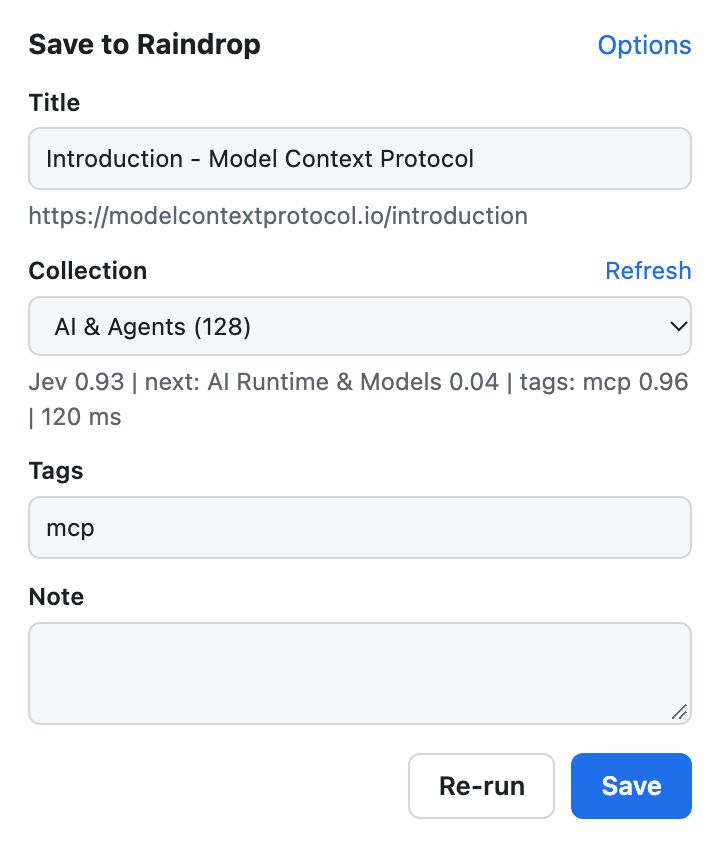

# Raindrop Autosort

English | [한국어](README.ko.md)

A Chrome extension (Manifest V3) that saves the current tab to [Raindrop.io](https://raindrop.io).
TypeSafe Jev picks the collection and the tags for each bookmark.

You list your collections with a short criterion for each. Jev reads the page and selects one
collection from that list. If Jev is not sure, the bookmark goes to a fallback collection, and the
popup lets you change the collection before you save.

This is an unofficial extension. Raindrop.io did not make it and does not endorse it.
Raindrop.io does not choose a collection for a new bookmark from criteria that you write.
This extension adds that step to the Raindrop.io save flow.



The popup in this image shows sample data.

## Requirements

- Chrome or another Chromium browser that loads unpacked extensions.
- A Raindrop.io account. Log in at app.raindrop.io in the same browser, or use a test token.
- A Jev API key for the System One endpoint.

## Install

1. Clone this repository.
2. Open `chrome://extensions` and turn on Developer mode.
3. Click "Load unpacked" and select the repository folder.
4. Open the extension Options page and paste your Jev API key.
5. Click "Add my collections". Write a criterion after each colon, then click Save.
6. Click "Test connections".

If the test succeeds, the status line shows `Raindrop OK` with the number of collections, and
`Jev OK` with the collection that Jev picks for a sample bookmark.

## Use

- Toolbar popup: check the collection, edit the title, tags and note, then click Save.
  "Refresh" reloads the collection list. "Re-run" asks Jev again.
- `Alt+Shift+S`: classify and save without the popup. The badge shows `OK`, `ERR` or `DUP`.
  Hover over the icon to see the target collection or the error.
- Right-click a link, then click "Save link to Raindrop (auto-sort)".

The popup tells you if the URL is already in Raindrop. You can save it again.
The `Alt+Shift+S` shortcut does not save a URL that is already in Raindrop.

## How a bookmark is classified

1. The extension reads the title, the meta description, the selected text and the start of the
   `article` or `main` text. On X and Threads post pages, it reads only the focal post.
2. It checks the rules. If a rule matches, the rule sets the collection, and Jev picks only the tags.
3. If no rule matches, it sends one request to Jev. The candidates are the collections in
   "Jev candidates", each with its criterion.
4. If the confidence is less than the minimum (default `0.7`), the bookmark goes to the fallback
   collection (default `Inbox`). If the fallback collection does not exist, it goes to `Unsorted`.
5. The same request asks one yes/no question for each tag in the tag vocabulary. Tags with a
   probability of `0.7` or more are added, at most 4, highest first.

The extension never creates collections. Jev cannot add a tag that is not in the tag vocabulary.
A right-click save knows only the link URL and the selected text, unless you turn on
"Read the linked page's title and description" in Options.

## Settings

All settings are on the Options page. The API key and the Raindrop test token stay in
`chrome.storage.local`. Other settings sync with your browser profile.

### Rules

One rule on each line. Rules are checked in order, and the first match wins.
Lines that start with `#` are comments.

```text
news.ycombinator.com => Reading
/github\.com\/[^/]+\/[^/]+$/ => Dev / Repositories
```

A host rule also matches subdomains. A `/regex/flags` rule is tested against the full URL.
The target is a collection title or a `Parent / Child` path.

### Jev candidates

One collection on each line, in the format `<collection> : <criterion>`.
Only the listed collections go to Jev.

```text
Dev : Software design, programming languages, libraries and developer tools.
Personal : Shopping, travel, restaurants and other non-work topics. Not technology news.
Inbox : None of the other collections clearly fits.
```

Jev reads each criterion literally. Write the exclusions out, as in the `Personal` line above.
If no line matches a collection, Jev gets all collections with only their paths as criteria.

The built-in list is an example for one set of collections. Replace it with your own collections.

### Tag vocabulary

One tag on each line, in the format `<tag> : <when the tag applies>`.

```text
mcp : The page is about the Model Context Protocol: an MCP server, client, or the protocol itself.
```

Tags are changed to lowercase, and spaces become hyphens. "Add my Raindrop tags" adds the tags
from your Raindrop account, most used first. A line without a condition is ignored.

### Settings issues and suggested rules

The Options page lists lines that the classifier ignores: rules with an unknown collection or
an invalid regex, candidates with an unknown collection or no criterion, and tags with no
condition. It also tells you when the fallback collection does not exist.

When you change Jev's pick in the popup, the extension records the host and your collection.
If you move the same host to the same collection two times, Options suggests a rule for it.
Click "Add", then click Save.

### Raindrop authentication

The default mode uses your app.raindrop.io login cookie and the API that the Raindrop web app
calls (`https://api.raindrop.io/v1`). This API is not documented and can change.

For the documented API, select "Test token". Create the token at
`app.raindrop.io/settings/integrations`. The extension then calls `https://api.raindrop.io/rest/v1`.
The tag import and the duplicate check are documented for the token mode only. In the
login-cookie mode, they are not tested. If they fail, the popup shows the error, and you can
still classify and save.

### Jev endpoint

The default endpoint is `https://api.typesafe.ai/v1/systemone`. If you set an endpoint on a
different host, Chrome asks for permission to that host when you click Save.

A Jev request times out after 15 seconds and is sent one more time. After two timeouts,
the popup shows `Jev timed out after 15 s`.

## Permissions and data

| Permission | Use |
|---|---|
| `activeTab`, `scripting` | Read the title and text of the tab that you save. |
| `storage` | Keep settings, the collection cache and your corrections. |
| `contextMenus` | Add the right-click menu item for links. |
| `api.raindrop.io`, `api.typesafe.ai` | Call Raindrop and Jev. |
| All sites (optional) | Read linked pages for right-click saves, or call a Jev endpoint on another host. |

For each classification, the extension sends this data to the Jev endpoint: the URL, the title,
the site name, the description, the selected text and up to 600 characters of page text.

## Development

The extension has no build step. Chrome loads the source files directly.

The tests use the Node.js test runner and need Node.js 22 or later. They replace `fetch` and the
`chrome` APIs with stubs, so they do not call Raindrop or Jev.

```sh
npm test
```

The tests cover `lib/`. The page reader `extractPageInfo` runs in the browser DOM and has no test.
After you change it, load the extension and save a page to check it.

| Path | Content |
|---|---|
| `lib/classify.js` | Page reading, rules, Jev request, settings checks and rule suggestions |
| `lib/raindrop.js` | Raindrop API client |
| `lib/settings.js` | Default settings and storage |
| `background.js` | Keyboard shortcut and right-click menu |
| `popup.js`, `options.js` | Popup and Options pages |

## Versioning

The project uses [Semantic Versioning](https://semver.org/). The version is in `manifest.json`
and in `package.json`, and the Options page shows it next to the title.
Each release has a section in [CHANGELOG.md](CHANGELOG.md) and a `v<version>` Git tag.

To make a release:

1. Add your changes under `## [Unreleased]` in `CHANGELOG.md`.
2. Set the same new version in `manifest.json` and `package.json`.
3. Rename `## [Unreleased]` to `## [<version>] - <date>`, and add an empty `## [Unreleased]` above it.
4. Run `npm test`. The test fails if the two versions differ or the changelog has no section for the version.
5. Commit, then create the tag `v<version>`.

## License

[MIT](LICENSE)
